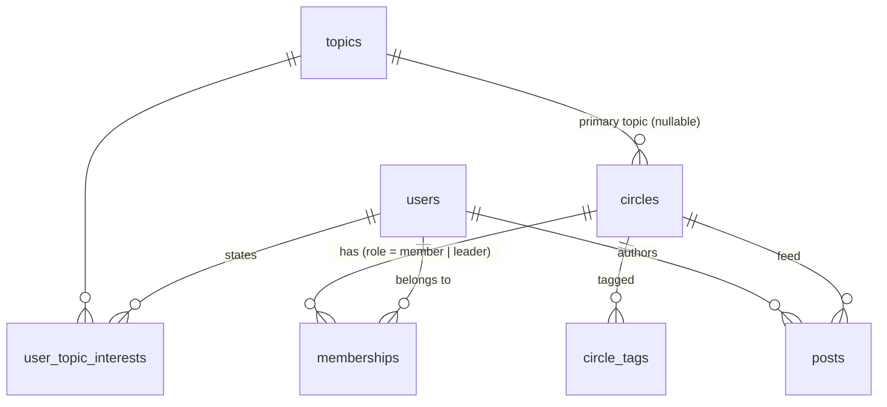

# Database schema

DDL: [`db/schema.sql`](../db/schema.sql). SQLite for zero-setup. It ports to Postgres by swapping
`TEXT` timestamps for `TIMESTAMPTZ` and `INTEGER` booleans for `BOOLEAN`.

| Table | Key | Notes |
|---|---|---|
| `topics` | `id`, `slug` UNIQUE | Canonical taxonomy. Everything else references the **slug**: it's stable and readable, and it's what the source data uses. |
| `users` | `id` | Profile fields as given. |
| `user_topic_interests` | PK `(user_id, topic_slug)` | Stated interests, normalized out of the JSON array so both directions are index lookups. |
| `circles` | `id`, `slug` UNIQUE | `topic_slug` nullable. `max_members` NULL = uncapped. `member_count`, `feed_posts_30d` and `chat_messages_30d` are denormalized aggregates. |
| `circle_tags` | PK `(circle_id, tag)` | Free-form tags, kept separate from the canonical topic because they're noisier and weighted lower. |
| `memberships` | PK `(user_id, circle_id)` | Leaders are members with `role='leader'`, so there's no separate table. |
| `posts` | `id` | Feed posts with engagement counts (`activity.json`). |

## Indexes and why

| Index | Serves |
|---|---|
| PK `memberships(user_id, circle_id)` | "Which Circles is she in?", the exclusion step on every request. Also enforces one membership per pair. |
| `memberships(circle_id, role)` | Leader lookup and per-Circle member scans (industry peers). |
| `posts(circle_id, created_at)` | "Engagement in Circle C over the last 30 days" as a range scan, with no table scan. |
| `user_topic_interests(topic_slug)` | Reverse lookup ("who cares about X") for candidate generation and analytics. |
| `circle_tags(tag)` | Tag-based candidate lookup. |
| `circles(access, topic_slug)` | At scale: "public Circles on topics T1..Tn" as the first candidate-generation query. |

## Design decisions
- **Derived state isn't stored.** Whether a Circle is full, its spots left, days since activity
  and recent engagement are computed in one parameterized query relative to `as_of`
  (`app/repository.py`). Storing `is_full` invites drift. In production these move to a
  `circle_stats` table refreshed by a job, because aggregating posts per request doesn't scale.
- **Denormalized counters kept.** `member_count` and the 30-day aggregates mirror the source
  data and the real product (cheap reads, written on join/leave and by a rollup job). The
  membership table stays the source of truth.
- **CHECK constraints** on the enums (`format`, `access`, `join_policy`, `role`) catch bad
  seed data at load time instead of in the ranking.
- **Foreign keys on**, with `ON DELETE CASCADE` from users/circles to their join rows.
